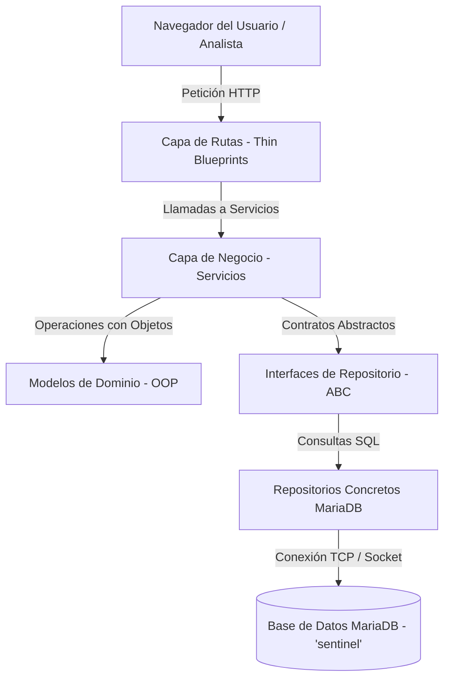

# PROJECT SENTINEL — Technical & Security Architecture Report
## Informe Técnico de Arquitectura, Superficie de Ataque y Control de Acceso
**Nexus Digital Solutions (NDS) · Internal Cybersecurity Platform**  
**Document Version:** 2.0 (Fases 1 y 2)  
**Authors:** Lander García Dávila & Jone López San Juan (Sentinel Engineering Squad)  
**Stakeholders:** CEO Miren Arriaga, CTO Eneko Bermejo, SOC Manager Nerea Agirre  
**Project Repository:** `/var/www/html/Sentinel`  

---

## Resumen Ejecutivo

Este documento constituye la memoria técnica, especificación de diseño de sistemas y auditoría de seguridad de **Sentinel**, la plataforma de gestión de incidentes de seguridad desarrollada internamente para **Nexus Digital Solutions (NDS)**.

El proyecto surge para resolver la exposición de información sensible debida al uso de hojas de cálculo compartidas y canales de mensajería. Tras el desarrollo del prototipo base, la Responsable del SOC (Nerea Agirre) registró la incidencia **INC-2026-001**, descubriendo una vulnerabilidad de tipo IDOR (*Insecure Direct Object Reference*) que permitía a cualquier empleado visualizar incidentes de clientes reportados por otros compañeros simplemente cambiando el identificador numérico en la URL.

Este informe da cumplimiento formal a la totalidad de los requisitos especificados en:
1. **Fase 1 (Fundamentos de la Aplicación y Arquitectura Orientada a Objetos):**
   * **Team Charter (R18):** Organización del squad, roles, normas y flujo en Git.
   * **Informe de Seguridad y Diseño — Sección 1 (R19):** Arquitectura en 3 capas, modelos de dominio, interfaces de repositorio y catálogo de atajos técnicos del prototipo base.
2. **Fase 2 (Superficie de Ataque, Autenticación y Control de Acceso):**
   * **Mapeo de la Superficie de Ataque (R1, R2, R9):** Inventario exhaustivo de todos los endpoints, entradas, parámetros, archivos y fronteras de confianza.
   * **Autenticación y Control de Acceso — Sección 2 (R3–R9):** Modelo de roles (RBAC/ABAC), contraseñas seguras con `bcrypt`, control y expiración de sesiones por inactividad y resolución completa del IDOR.

---

# 1. Team Charter del Squad (Requisito R18 — Fase 1)

### 1.1 Composición y Roles del Equipo
* **Nombre del Squad:** Sentinel Security Engineering Squad (Nexus Squad 4)
* **Organización:** Nexus Digital Solutions (NDS)
* **Misión:** Diseñar, desarrollar, securizar y operar la plataforma Sentinel para brindar al SOC y a la plantilla de NDS una herramienta centralizada, fiable y auditable de gestión de incidentes.

| Miembro del Squad | Rol de Ingeniería | Responsabilidades Clave |
| :--- | :--- | :--- |
| **Lander García Dávila** | **Lead Backend Engineer & Security Architect** | Diseño de modelos de dominio OOP (`User`, `Incident`, `Comment`, `Attachment`), persistencia MariaDB con interfaces abstractas (`abc.ABC`), lógica de negocio en servicios, implementación de hashing seguro con `bcrypt` y protección estricta contra IDOR. |
| **Jone López San Juan** | **DevOps, Infrastructure & Frontend Specialist** | Despliegue en Apache2 con `mod_wsgi`, configuración y gestión de MariaDB, entornos virtuales, plantillas Jinja2, diseño visual SOC dark theme, modal interactivo de expiración de sesión y documentación de puesta en marcha. |

### 1.2 Acuerdos de Trabajo (Working Agreement & Definition of Done)

1. **Separación Estricta de Capas (3-Tier Architecture):**
   * Las rutas web nunca tocan la base de datos ni ejecutan consultas SQL directamente.
   * Los servicios nunca construyen HTML ni procesan objetos `request` o `session` de Flask.
2. **Orientación a Objetos y Contratos:**
   * Las entidades de dominio encapsulan su estado mediante atributos privados (`_id`, `_username`, `_password`, `_title`) y decoradores `@property`.
   * Los repositorios de persistencia se implementan detrás de interfaces abstractas (`IBaseRepository`, `IUserRepository`, etc.).
3. **Seguridad en el Servidor:**
   * No se confía en validaciones del cliente o del navegador. Toda decisión de autorización (RBAC/ABAC) se valida en el backend en cada petición.
4. **Transparencia Técnica:**
   * Todo atajo asumido por motivos de entrega rápida debe quedar catalogado con su categoría OWASP correspondiente.

### 1.3 Flujo de Trabajo en Git y Control de Versiones

* **Repositorio Oficial:** Alojado en GitHub (`https://github.com/Landertale/Sentinel.git`).
* **Estrategia de Ramas:**
  * Rama principal `main`: Rama de producción protegida y desplegable en Apache2 mediante WSGI.
  * Commits atómicos, frecuentes y significativos (*commit early, commit often*).
* **Convención de Commits:**
  * Uso de mensajes descriptivos con prefijo de componente (ej. `Security features: bcrypt passwords, employee role with IDOR protection`, `uso de MariaDB`, `Elimination of residual code pending from when the application used sqlite`).

---

# 2. Arquitectura y Diseño del Sistema (Requisito R19 — Fase 1)

### 2.1 Visión General de la Aplicación

Sentinel resuelve la problemática de gestión de incidentes de NDS integrando las siguientes funcionalidades:
* **Autenticación de usuarios:** Registro, inicio y cierre de sesión seguro.
* **Ciclo de vida de incidentes:** Creación con título, descripción y severidad (`LOW`, `MEDIUM`, `HIGH`, `CRITICAL`), seguimiento de estados (`New`, `Assigned to`, `Resolved`) y asignación a analistas.
* **Listado y detalle:** Visualización ordenada cronológicamente (más recientes primero) y vista detallada individual.
* **Notas de investigación:** Comentarios colaborativos vinculados a cada incidente.
* **Búsqueda:** Filtrado por coincidencia de subcadena en títulos y descripciones.
* **Archivos adjuntos:** Almacenamiento y descarga de artefactos y evidencias forenses.
* **Previsualización de enlaces:** Extracción automática de títulos HTML `<title>` desde enlaces de inteligencia de amenazas.
* **Preferencias:** Almacenamiento en cookie del filtro de severidad predeterminado.

---

### 2.2 Estructura en 3 Capas (R10)

Sentinel implementa una arquitectura modular desacoplada:



* **Capa de Rutas (`app/routes/`):** Controladores ligeros (`auth_routes.py`, `incident_routes.py`, `main_routes.py`) que gestionan la petición HTTP entrante, validan la sesión, invocan el servicio correspondiente y devuelven la plantilla Jinja2 o redirección.
* **Capa de Negocio (`app/services/`):** Contiene la lógica operativa (`AuthService`, `IncidentService`, `PreviewService`), coordinando las reglas de negocio, hashing de contraseñas y repositorios.
* **Capa de Persistencia (`app/repositories/`):** Aísla el acceso a datos (`database.py`, `user_repository.py`, `incident_repository.py`, `comment_repository.py`) detrás de interfaces abstractas.
* **Capa de Dominio (`app/models/`):** Define las clases del negocio (`user.py`, `incident.py`, `comment.py`, `attachment.py`).

---

### 2.3 Ingeniería Orientada a Objetos (R12 a R16)

* **Encapsulamiento (R12, R13):** Las entidades protegen sus atributos como privados (`_id`, `_username`, `_password`, `_title`, etc.) y exponen getters/setters controlados mediante `@property`.
* **Herencia y Polimorfismo (R14):** Se define la clase base `User` y sus subclases especializadas `Employee`, `Analyst` y `Admin`, implementando métodos polimórficos como `can_view_all_incidents()`, `can_delete_incidents()` y `is_admin()`.
* **Interfaces Abstractas (R15):** Se utilizan `abc.ABC` y `typing.Generic[T]` para definir los contratos `IBaseRepository`, `IUserRepository`, `IIncidentRepository` e `ICommentRepository`.
* **Factoría de Dominio:** La función `user_factory` crea la instancia concreta de usuario adecuada en función del rol almacenado.

---

### 2.4 Registro de Atajos Deliberados del Prototipo Base (Fase 1 / R19)

Para cumplir el plazo inicial de 3 semanas bajo premisa de prototipado rápido, se catalogaron formalmente los siguientes atajos en el prototipo base:

| ID | Componente Afectado | Descripción del Atajo Técnico | Categoría OWASP |
| :--- | :--- | :--- | :--- |
| **SC-01** | `auth_service.py`<br>`user_repository.py` | **Contraseñas en texto plano:** Contraseñas recibidas, almacenadas y comprobadas en texto plano sin salt ni hash criptográfico. | **A07: Identification & Authentication Failures** |
| **SC-02** | `incident_repository.py`<br>`user_repository.py` | **Consultas SQL con interpolación:** Consultas construidas con f-strings (`LIKE '%{search_term}%'`) sin parámetros preparados. | **A03: Injection (SQLi)** |
| **SC-03** | `detail.html`<br>`comment_repository.py` | **Renderizado HTML en bruto:** Comentarios mostrados con el filtro `\| safe` de Jinja2 sin saneamiento de scripts. | **A03: Injection (Stored XSS)** |
| **SC-04** | Todos los formularios<br>`incident_routes.py` | **Ausencia de tokens CSRF:** Formularios POST sin validación contra Cross-Site Request Forgery. | **A01: Broken Access Control** |
| **SC-05** | `incident_service.py`<br>`uploads/` | **Subida de archivos sin restricción:** Archivos guardados con el nombre original sin validar extensiones ni usar identificadores UUID. | **A04: Insecure Design** |
| **SC-06** | `preview_service.py` | **Peticiones URL externas sin filtrar:** Descarga de contenidos mediante `urllib.request` sin bloquear rangos privados (127.0.0.1, subredes locales). | **A10: Server-Side Request Forgery (SSRF)** |
| **SC-07** | `app/__init__.py`<br>`incident_routes.py` | **Cookies sin directivas de seguridad:** Cookies almacenadas sin las directivas `HttpOnly`, `Secure` o `SameSite`. | **A05: Security Misconfiguration** |
| **SC-08** | `app/__init__.py` | **Clave secreta débil y estática:** Variable `SECRET_KEY` definida con un valor constante en el código. | **A02: Cryptographic Failures** |
| **SC-09** | `run.py` | **Servidor de depuración en 0.0.0.0:** Prototipo ejecutado inicialmente con `debug=True` visible en red. | **A05: Security Misconfiguration** |

---

# 3. Mapeo de la Superficie de Ataque (Requisitos R1, R2 y R9 — Fase 2)

### 3.1 Contexto: Incidente INC-2026-001 (Vulnerabilidad IDOR)

* **Descripción:** La Responsable del SOC, Nerea Agirre, comprobó que modificando el número en la URL `/incidents/<incident_id>`, un empleado común podía inspeccionar incidentes ajenos con datos confidenciales de clientes.
* **Causa Raíz:** Ausencia de comprobación de autorización en el servidor sobre el objeto solicitado. El código original tomaba el ID numérico de la URL y devolvía el incidente sin comprobar si el usuario en sesión era el autor del informe o si contaba con privilegios de Analista/Administrador.

---

### 3.2 Inventario de Endpoints y Clasificación de Entradas (R1, R2)

Sentinel expone **14 endpoints de aplicación**:

| Endpoint y Método | Función Controladora | ¿Requiere Autenticación? | Roles Autorizados | Entradas y Origen | Controlado Por | Propósito y Flujo de Datos | Frontera de Confianza y Riesgo |
| :--- | :--- | :---: | :--- | :--- | :--- | :--- | :--- |
| **`GET /`** | `main.index` | No | Cualquiera | Ninguna | N/A | Redirige al listado si hay sesión, o al login. | Frontera pública. Riesgo bajo. |
| **`GET /register`** | `auth.register` | No | Anónimo | Ninguna | N/A | Muestra el formulario de registro. | Frontera pública. |
| **`POST /register`** | `auth.register` | No | Anónimo | `username` (Form)<br>`password` (Form)<br>`role` (Form) | Atacante / Cliente | Registra usuario. Encripta con bcrypt y guarda en base de datos. | **Frontera Crítica.** Riesgos: Inyección SQL, manipulación de rol en formulario. |
| **`GET /login`** | `auth.login` | No | Anónimo | Ninguna | N/A | Muestra el formulario de login. | Frontera pública. |
| **`POST /login`** | `auth.login` | No | Anónimo | `username` (Form)<br>`password` (Form) | Atacante / Cliente | Autentica credenciales, crea sesión e inicializa temporizador de 10 min. | **Frontera Crítica.** Riesgos: Fuerza bruta, enumeración de usuarios. |
| **`GET /logout`** | `auth.logout` | Sí | Cualquier usuario autenticado | Cookie de sesión | Navegador | Destruye la sesión del servidor con `session.clear()`. | Frontera de sesión. |
| **`POST /extend-session`** | `auth.extend_session` | Sí | Cualquier usuario autenticado | Cookie de sesión | Cliente (AJAX) | Renueva la marca de tiempo `last_activity` por 10 minutos. | Frontera interna de sesión. |
| **`GET /incidents`** | `incidents.list_incidents` | Sí | Employee, Analyst, Admin | `q` (Query)<br>`severity` (Query)<br>`status` (Query)<br>`sentinel_severity_pref` (Cookie) | Atacante / Cliente | Lista y filtra incidentes. Para `employee` restringe por `created_by=session['username']`. | **Frontera de Consulta.** Riesgos: Inyección SQL en búsqueda; manipulación de cookie. |
| **`GET /incidents/new`** | `incidents.create_incident` | Sí | Employee, Analyst, Admin | Ninguna | N/A | Carga formulario de nuevo incidente y lista de analistas disponibles. | Frontera autenticada. |
| **`POST /incidents/new`** | `incidents.create_incident` | Sí | Employee, Analyst, Admin | `title` (Form)<br>`description` (Form)<br>`severity` (Form)<br>`status` (Form)<br>`assigned_to` (Form)<br>`source_url` (Form)<br>`attachment` (File) | Atacante / Cliente | Guarda incidente. Restringe a empleados a estado `New` y sin asignación. | **Frontera de Alto Riesgo.** Riesgos: SSRF en `source_url`, subida de ficheros y SQLi. |
| **`GET /incidents/<id>`** | `incidents.detail_incident` | Sí | Employee (solo propios), Analyst, Admin | `incident_id` (Path) | Atacante / Cliente | Muestra detalle y comentarios. Validación IDOR: aborta 403 si `employee` $\neq$ creador. | **Frontera IDOR (INC-2026-001).** Riesgos: Acceso indebido a datos. |
| **`POST /incidents/<id>/status`** | `incidents.update_status` | Sí | Analyst, Admin (Employee bloqueado) | `incident_id` (Path)<br>`status` (Form)<br>`assigned_to` (Form) | Atacante / Cliente | Actualiza estado y asigna analista. Rechaza a empleados en el servidor. | **Frontera de Autorización.** Riesgos: Escalada vertical de privilegios. |
| **`POST /incidents/<id>/delete`** | `incidents.delete_incident` | Sí | Admin únicamente | `incident_id` (Path) | Atacante / Cliente | Elimina definitivamente el incidente. Valida rol `admin` en servidor. | **Operación Destructiva.** Riesgos: Borrado no autorizado. |
| **`POST /incidents/<id>/comments`** | `incidents.add_comment` | Sí | Employee (solo propios), Analyst, Admin | `incident_id` (Path)<br>`content` (Form) | Atacante / Cliente | Añade nota forense. Valida titularidad antes de guardar. | **Frontera de Contenido.** Riesgos: XSS almacenado en `content`. |
| **`POST /preferences`** | `incidents.set_preferences` | Sí | Cualquier usuario autenticado | `default_severity` (Form) | Atacante / Cliente | Modifica cookie de preferencia `sentinel_severity_pref`. | Frontera de cliente. |
| **`GET /uploads/<file>`** | `incidents.download_attachment` | Sí | Employee (solo propios), Analyst, Admin | `filename` (Path) | Atacante / Cliente | Descarga de evidencias. Empleados solo pueden descargar adjuntos de sus incidentes. | **Frontera de Archivos.** Riesgos: Descarga de ficheros confidenciales ajenos. |
| **`GET /static/<file>`** | Gestor estático | No | Público | `filename` (Path) | Cliente | Entrega de archivos CSS y estáticos del sistema. | Frontera pública. |

---

### 3.3 Clasificación por Frontera de Confianza (R2)

1. **Identificadores numéricos de URL (`incident_id`):** Provienen del cliente. Se validan en el servidor comprobando el rol y la autoría antes de procesar el acceso.
2. **Parámetros de búsqueda y filtros (`q`, `severity`, `status`):** Provienen de query string. Se transfieren a la capa de persistencia.
3. **Credenciales y rol (`username`, `password`, `role`):** Provienen de formularios POST. El rol se valida contra una lista blanca fija (`employee`, `analyst`, `admin`).
4. **Contenido de texto libre (`title`, `description`, `content`):** Almacenados en base de datos.
5. **URL externa (`source_url`):** Provoca una petición de red externa saliente ejecutada por `PreviewService`.
6. **Fichero adjunto (`attachment`):** Se guarda en el sistema de archivos (`app/static/uploads/`) usando `os.path.basename`.

---

# 4. Autenticación y Control de Acceso (Requisitos R3–R9 — Fase 2)

### 4.1 Sistema de Autenticación y Contraseñas Seguras (R3, R4)

* **Hashing Criptográfico con Bcrypt (R4):** Se sustituyó el almacenamiento en texto plano. Cada contraseña se encripta mediante `bcrypt.hashpw()` con salt único aleatorio (`bcrypt.gensalt()`).
* **Migración Automática de Contraseñas:** Si un usuario existente en la base de datos inicia sesión con una contraseña en formato antiguo, el sistema valida las credenciales, genera al vuelo el hash `bcrypt` y actualiza el registro en MariaDB.
* **Control de Expiración de Sesiones por Inactividad (R3):**
  * Se establece una vigencia máxima de 10 minutos (`PERMANENT_SESSION_LIFETIME = timedelta(minutes=10)`).
  * Mediante `@app.before_request`, el servidor verifica `session['last_activity']`. Si transcurren más de 600 segundos sin interacción, la sesión se limpia (`session.clear()`) y se redirige a `/login` con un mensaje flash de expiración.
* **Modal de Advertencia y Extensión de Sesión:**
  * El frontend detecta la inactividad del usuario mediante eventos de ratón, teclado y scroll.
  * A los 8 minutos de inactividad (faltando 2 minutos para el cierre), se presenta un modal de advertencia que permite extender la sesión otros 10 minutos mediante una llamada POST a `/extend-session`.
* **Prevención de Fijación de Sesión:** La ruta `/logout` borra completamente el diccionario de sesión con `session.clear()`.

---

### 4.2 Modelo de Roles y Separación de Privilegios (R5)

Sentinel implementa tres roles claramente diferenciados:

| Capacidad / Operación | Empleado (`employee`) | Analista (`analyst`) | Administrador (`admin`) |
| :--- | :---: | :---: | :---: |
| **Crear incidentes** | Sí (Estado fijo `New`) | Sí (Puede asignar analista) | Sí (Puede asignar analista) |
| **Listar incidentes** | Solo incidentes propios | Todos los incidentes | Todos los incidentes |
| **Ver detalle de incidente** | Solo incidentes propios | Todos los incidentes | Todos los incidentes |
| **Publicar comentarios** | Solo en incidentes propios | En cualquier incidente | En cualquier incidente |
| **Descargar adjuntos** | Solo de incidentes propios | De cualquier incidente | De cualquier incidente |
| **Cambiar estado o analista** | ❌ Bloqueado por servidor | ✅ Permitido | ✅ Permitido |
| **Eliminar incidentes** | ❌ Bloqueado por servidor | ❌ Bloqueado por servidor | ✅ Permitido (Exclusivo) |

---

### 4.3 Mecanismo de Control de Acceso y Solución de IDOR (R6, R7, R8)

La vulnerabilidad INC-2026-001 se resolvió aplicando comprobaciones obligatorias en el servidor:

1. **En la vista de detalle (`/incidents/<id>`):**
   ```python
   incident, comments = incident_service.get_incident_details(incident_id)
   if not incident:
       abort(404)

   # Protección estricta contra IDOR
   if session.get("role") == "employee" and incident.created_by != session.get("username"):
       abort(403)
   ```
2. **En el listado general (`/incidents`):**
   Se pasa al servicio el parámetro `created_by=session['username']` cuando el rol es `employee`, impidiendo que la consulta SQL retorne incidentes de terceros.
3. **En la descarga de archivos adjuntos (`/uploads/<filename>`):**
   El servidor comprueba que el nombre del fichero solicitado coincida con alguno de los incidentes creados por el usuario en sesión antes de autorizar la entrega mediante `send_from_directory`.
4. **En la publicación de comentarios (`/incidents/<id>/comments`):**
   Se valida la coincidencia de autoría antes de persistir cualquier comentario.

---

# 5. Conclusión y Verificación

La plataforma Sentinel ha alcanzado con éxito los objetivos de las Fases 1 y 2, resolviendo integralmente la vulnerabilidad INC-2026-001 (IDOR), incorporando almacenamiento criptográfico con Bcrypt, control riguroso de sesiones con expiración por inactividad y un modelo de autorización consistente aplicado en el servidor en cada petición.

**Firmado por el Sentinel Engineering Squad:**  
* **Lander García Dávila**, Lead Backend Engineer & Security Architect  
* **Jone López San Juan**, DevOps, Infrastructure & Frontend Specialist
