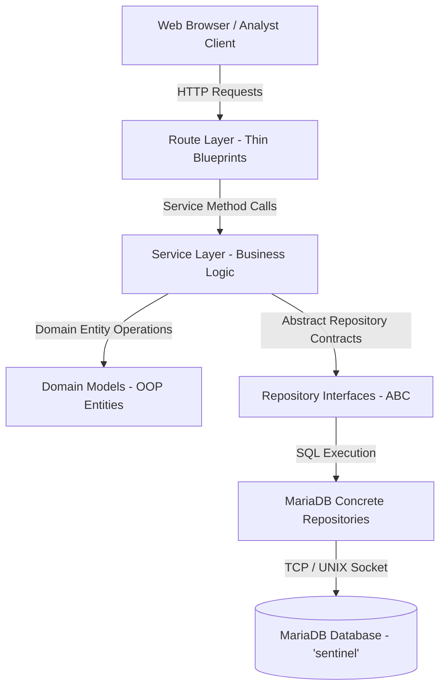

# PROJECT SENTINEL — Technical & Security Architecture Report
## Systems Architecture, Attack Surface Mapping & Access Control Documentation
**Nexus Digital Solutions (NDS) · Internal Cybersecurity Platform**  
**Document Version:** 2.0 (Phases 1 & 2)  
**Authors:** Lander García Dávila & Jone López San Juan (Sentinel Engineering Squad)  
**Stakeholders:** CEO Miren Arriaga, CTO Eneko Bermejo, SOC Manager Nerea Agirre  
**Project Repository:** `/var/www/html/Sentinel`  

---

## Executive Summary

This document serves as the authoritative technical specification, system design manual, and security audit report for **Sentinel**, an internal Security Incident Management Platform engineered for **Nexus Digital Solutions (NDS)**.

The project was commissioned to eliminate severe data leakage risks resulting from the use of uncoordinated spreadsheets and chat channels for security tracking. Following the deployment of the initial base prototype, SOC Manager Nerea Agirre filed security incident report **INC-2026-001**, discovering an Insecure Direct Object Reference (IDOR) vulnerability that allowed standard employees to inspect confidential client incident records created by other staff simply by changing the numeric ID in the URL.

This report satisfies all documentation requirements for **Phase 1** and **Phase 2**:
1. **Phase 1 (Application Foundations & Object-Oriented Architecture):**
   * **Team Charter (R18):** Squad organization, roles, working agreements, and Git workflow.
   * **Security & Design Report — Section 1 (R19):** 3-tier modular architecture, domain models, interface abstractions, and catalog of intentional baseline shortcuts.
2. **Phase 2 (Attack Surface Mapping, Authentication & Access Control):**
   * **Attack Surface Map (R1, R2, R9):** Complete inventory of all endpoints, parameters, data flows, trust boundaries, and controller mappings.
   * **Authentication & Access Control — Section 2 (R3–R9):** Role-based access control (RBAC/ABAC), cryptographic password hashing with `bcrypt`, inactivity session timeout handling, and end-to-end server-side IDOR remediation.

---

# 1. Team Charter (Requirement R18 — Phase 1)

### 1.1 Squad Overview & Role Assignments
* **Squad Name:** Sentinel Security Engineering Squad (Nexus Squad 4)
* **Organization:** Nexus Digital Solutions (NDS)
* **Mission:** Design, develop, secure, and operate the Sentinel platform to provide SOC analysts and NDS personnel with a centralized, reliable, and auditable incident lifecycle tool.

| Squad Member | Engineering Role | Core Responsibilities |
| :--- | :--- | :--- |
| **Lander García Dávila** | **Lead Backend Engineer & Security Architect** | OOP domain entity design (`User`, `Incident`, `Comment`, `Attachment`), repository layer abstractions (`abc.ABC`), MariaDB persistence, service business logic, `bcrypt` password hashing, and server-side IDOR mitigation. |
| **Jone López San Juan** | **DevOps, Infrastructure & Frontend Specialist** | Apache2 `mod_wsgi` deployment, MariaDB configuration, virtual environment management, Jinja2 presentation templates, SOC dark theme CSS, session inactivity modal, and operations manual. |

### 1.2 Working Agreements & Definition of Done (DoD)

1. **Strict 3-Tier Layered Architecture:**
   * Routes parse requests and invoke services; routes *never* touch the database directly or execute SQL queries.
   * Services encapsulate business logic and *never* construct HTML or handle Flask `request` or `session` objects directly.
2. **Object-Oriented Integrity & Interface Contracts:**
   * Domain models encapsulate internal state using private attributes (`_id`, `_username`, `_password`, `_title`) and `@property` decorators.
   * Repositories are implemented behind formal abstract interfaces (`IBaseRepository`, `IUserRepository`, etc.).
3. **Server-Side Security Enforcement:**
   * Never trust client-side or browser validation. All authorization checks (RBAC/ABAC) are strictly validated on the server for every request.
4. **Technical Transparency:**
   * All shortcuts adopted to satisfy rapid prototyping timelines are formally recorded in the Vulnerability & Shortcut Register with corresponding OWASP classifications.

### 1.3 Git Workflow & Version Control Conventions

* **Official Repository:** Hosted on GitHub (`https://github.com/Landertale/Sentinel.git`).
* **Branching Strategy:**
  * Protected `main` branch, continuously deployable to Apache2 WSGI.
  * Commits are frequent, atomic, and descriptive (*commit early, commit often*).
* **Commit Conventions:**
  * Semantic component prefixes (e.g., `Security features: bcrypt passwords, employee role with IDOR protection`, `uso de MariaDB`, `Elimination of residual code pending from when the application used sqlite`).

---

# 2. System Architecture & Design (Requirement R19 — Phase 1)

### 2.1 Application Overview & Problem Statement

Sentinel provides an internal management dashboard for security incident response:
* **User Authentication & Management:** Secure registration, authentication, and session teardown.
* **Incident Lifecycle Management:** Incident reporting with severity classification (`LOW`, `MEDIUM`, `HIGH`, `CRITICAL`), status progression (`New`, `Assigned to`, `Resolved`), and analyst assignment.
* **Incident Queue & Detail Views:** Chronological incident queue (most recent first) and comprehensive incident detail views.
* **Collaborative Timeline & Notes:** Investigation comments and forensic notes attached directly to incident records.
* **Substring Search:** Fast filtering across incident titles and descriptions.
* **Evidence Attachments:** Upload and download of forensic log artifacts and packet captures.
* **Threat Intelligence Link Preview:** Automated extraction of HTML `<title>` tags from external URLs.
* **Client Preferences:** Cookie-based retention of user-selected default severity filters.

---

### 2.2 Layered 3-Tier Architecture (R10)

Sentinel adheres strictly to a decoupled 3-tier object-oriented architecture:



* **Route / Presentation Layer (`app/routes/`):** Thin controllers (`auth_routes.py`, `incident_routes.py`, `main_routes.py`) responsible for parsing incoming HTTP requests, inspecting session cookies, invoking service methods, and returning Jinja2 templates or redirects.
* **Service / Business Logic Layer (`app/services/`):** Encapsulates core application logic (`AuthService`, `IncidentService`, `PreviewService`), cryptographic password hashing, link previews, and repository coordination.
* **Data Access / Repository Layer (`app/repositories/`):** Decouples data storage behind abstract interfaces (`IBaseRepository`, `IUserRepository`, `IIncidentRepository`, `ICommentRepository`) implemented for MariaDB.
* **Domain Entity Layer (`app/models/`):** Object-oriented domain entities (`User`, `Employee`, `Analyst`, `Admin`, `Incident`, `Comment`, `Attachment`).

---

### 2.3 Object-Oriented Engineering Principles (R12 to R16)

* **Encapsulation (R12, R13):** Entities protect state via private attributes (`_id`, `_username`, `_password`, `_title`, etc.) exposed safely via `@property` getters and setters.
* **Inheritance & Polymorphism (R14):** A class hierarchy rooted in `User` specializes into `Employee`, `Analyst`, and `Admin`. Polymorphic methods (`can_view_all_incidents()`, `can_delete_incidents()`, `is_admin()`) govern domain capabilities.
* **Abstract Interfaces (R15):** Formal contracts defined via `abc.ABC` and `typing.Generic[T]` guarantee decoupled database interactions.
* **Domain Factory (`user_factory`):** Instantiates the appropriate `User` subclass dynamically based on stored database role attributes.

---

### 2.4 Register of Deliberate Baseline Shortcuts (Phase 1 / R19)

To satisfy the rapid 3-week prototyping deadline of Phase 1, defensive controls were deferred. The table below catalogs all intentional baseline shortcuts:

| ID | Component / File | Shortcut Description | OWASP Top 10 Category |
| :--- | :--- | :--- | :--- |
| **SC-01** | `auth_service.py`<br>`user_repository.py` | **Plain-text passwords:** Passwords stored and checked in plain text without cryptographic hashing or salts. | **A07: Identification & Authentication Failures** |
| **SC-02** | `incident_repository.py`<br>`user_repository.py` | **Raw SQL string interpolation:** Queries constructed using f-strings (`LIKE '%{search_term}%'`) without parameterized statements. | **A03: Injection (SQLi)** |
| **SC-03** | `detail.html`<br>`comment_repository.py` | **Raw HTML rendering in comments:** Comments rendered using Jinja2 `\| safe` filter without HTML tag sanitization. | **A03: Injection (Stored XSS)** |
| **SC-04** | All forms in `templates/`<br>`incident_routes.py` | **Missing anti-CSRF tokens:** State-changing POST forms lack CSRF validation tokens. | **A01: Broken Access Control** |
| **SC-05** | `incident_service.py`<br>`uploads/` | **Unvalidated file uploads:** Uploaded files written directly to filesystem without extension whitelisting. | **A04: Insecure Design** |
| **SC-06** | `preview_service.py` | **Unvalidated external URL fetching:** External URLs fetched via `urllib` without private subnet or loopback IP filtering. | **A10: Server-Side Request Forgery (SSRF)** |
| **SC-07** | `app/__init__.py`<br>`incident_routes.py` | **Insecure cookie flags:** Cookies stored without `HttpOnly`, `Secure`, or `SameSite` flags. | **A05: Security Misconfiguration** |
| **SC-08** | `app/__init__.py` | **Hardcoded static secret key:** Flask `SECRET_KEY` set to static hardcoded string in repository. | **A02: Cryptographic Failures** |
| **SC-09** | `run.py` | **Debug server on 0.0.0.0:** Werkzeug development server bound to all interfaces with `debug=True`. | **A05: Security Misconfiguration** |

---

# 3. Attack Surface Mapping (Requirements R1, R2 & R9 — Phase 2)

### 3.1 Context: Incident INC-2026-001 (IDOR Vulnerability)

* **Incident Summary:** SOC Manager Nerea Agirre reported that standard employees could inspect confidential client incident records created by other staff simply by changing the numeric ID in the URL `/incidents/<incident_id>`.
* **Technical Root Cause:** The detail route retrieved incident objects directly using the client-provided URL integer without verifying whether the requesting user owned the record or possessed Analyst/Admin privileges. Sequential IDs made enumeration trivial, but the actual security defect was the complete absence of server-side authorization checks.

---

### 3.2 Endpoint Inventory & Input Classification (R1, R2)

Sentinel exposes **14 distinct application endpoints**:

| Endpoint & Method | Controller Function | Auth Required? | Authorized Roles | Input Parameters & Source | Controlled By | Purpose & Data Flow | Trust Boundary & Risk Vectors |
| :--- | :--- | :---: | :--- | :--- | :--- | :--- | :--- |
| **`GET /`** | `main.index` | No | Anonymous, Any | None | N/A | Landing dispatch; redirects to `/incidents` if session exists, else `/login`. | Boundary: Public web. Risk: Low. |
| **`GET /register`** | `auth.register` | No | Anonymous, Any | None | N/A | Renders user registration form. | Boundary: Public web. |
| **`POST /register`** | `auth.register` | No | Anonymous, Any | `username` (Form)<br>`password` (Form)<br>`role` (Form) | Attacker / Client | Creates user account. Hashes password via bcrypt; saves user in MariaDB. | **Critical Boundary:** Public input to database. Risks: SQL injection in repository, role tampering. |
| **`GET /login`** | `auth.login` | No | Anonymous, Any | None | N/A | Renders authentication form. | Boundary: Public web. |
| **`POST /login`** | `auth.login` | No | Anonymous, Any | `username` (Form)<br>`password` (Form) | Attacker / Client | Authenticates credentials; establishes session cookie; initializes activity timer. | **Critical Boundary:** Authentication gate. Risks: Brute force, credential stuffing. |
| **`GET /logout`** | `auth.logout` | Yes | Any Authenticated | Session cookie | Browser | Clears session via `session.clear()`; redirects to `/login`. | Boundary: Session teardown. |
| **`POST /extend-session`** | `auth.extend_session` | Yes | Any Authenticated | Session cookie | Browser / AJAX | Resets server session `last_activity` timestamp by 10 minutes. | Boundary: Internal session maintenance. |
| **`GET /incidents`** | `incidents.list_incidents` | Yes | Employee, Analyst, Admin | `q` (Query)<br>`severity` (Query)<br>`status` (Query)<br>`sentinel_severity_pref` (Cookie) | Attacker / Client | Filters and retrieves incident list. Enforces employee ownership filter (`created_by=session['username']`). | **Trust Boundary:** Query parameters to SQL. Risks: SQL injection via unparameterized query; preference cookie tampering. |
| **`GET /incidents/new`** | `incidents.create_incident` | Yes | Employee, Analyst, Admin | None | N/A | Renders incident creation form; loads analyst roster. | Boundary: Authenticated view. |
| **`POST /incidents/new`** | `incidents.create_incident` | Yes | Employee, Analyst, Admin | `title` (Form)<br>`description` (Form)<br>`severity` (Form)<br>`status` (Form)<br>`assigned_to` (Form)<br>`source_url` (Form)<br>`attachment` (File) | Attacker / Client | Persists incident. Restricts employees to `status='New'` and `assigned_to=None`. | **High Risk Boundary:** Direct file write + outbound network call + SQL write. Risks: SSRF, arbitrary file upload. |
| **`GET /incidents/<id>`** | `incidents.detail_incident` | Yes | Employee (own), Analyst, Admin | `incident_id` (Path) | Attacker / Client | Fetches incident details and comments. IDOR gate: aborts 403 if `employee` $\neq$ creator. | **IDOR Boundary (INC-2026-001):** Remediated gate. |
| **`POST /incidents/<id>/status`** | `incidents.update_status` | Yes | Analyst, Admin (Employee blocked) | `incident_id` (Path)<br>`status` (Form)<br>`assigned_to` (Form) | Attacker / Client | Updates incident status and assigns analyst. Server rejects employee updates with error flash. | **Authorization Boundary:** Vertical privilege boundary. |
| **`POST /incidents/<id>/delete`** | `incidents.delete_incident` | Yes | Admin Only | `incident_id` (Path) | Attacker / Client | Permanently deletes incident from database. Server verifies `session['role'] == 'admin'`. | **Critical Authorization Boundary:** Destructive operation. |
| **`POST /incidents/<id>/comments`** | `incidents.add_comment` | Yes | Employee (own), Analyst, Admin | `incident_id` (Path)<br>`content` (Form) | Attacker / Client | Appends investigation note. Validates employee ownership before accepting comment. | **High Risk Boundary:** Unescaped storage. Risks: Stored XSS in `content`. |
| **`POST /preferences`** | `incidents.set_preferences` | Yes | Any Authenticated | `default_severity` (Form) | Attacker / Client | Sets `sentinel_severity_pref` cookie for 30 days. | Boundary: Client cookie generation. |
| **`GET /uploads/<file>`** | `incidents.download_attachment` | Yes | Employee (own), Analyst, Admin | `filename` (Path) | Attacker / Client | Serves uploaded files via `send_from_directory`. Validates employee ownership against incident list. | **Filesystem Boundary:** Direct path serving. |
| **`GET /static/<file>`** | Static handler | No | Public / Any | `filename` (Path) | Client | Serves CSS stylesheets and client assets. | Boundary: Public web static route. |

---

### 3.3 Trust Boundary Input Classification (R2)

1. **Object Path Identifiers (`incident_id`, `filename`):** Controlled by client. Core trust boundary for INC-2026-001. Validated on the server by checking session user identity against record ownership prior to processing.
2. **Search & Filter Parameters (`q`, `severity`, `status`):** Controlled by client via URL query string. Passed to `MariaDBIncidentRepository.search_and_filter()`.
3. **Credentials & Roles (`username`, `password`, `role`):** Controlled by client via POST form. Role input is validated against a whitelist (`analyst`, `admin`, `employee`), falling back safely to `analyst` if manipulated.
4. **Free Text Content (`title`, `description`, `content`):** User-provided text stored in the database. Comments currently preserved verbatim.
5. **External Threat Intel URL (`source_url`):** Triggers an outbound HTTP request executed by `PreviewService`.
6. **File Artifacts (`attachment`):** Stored on local disk under `app/static/uploads/` using `os.path.basename`.

---

# 4. Authentication & Access Control (Requirements R3–R9 — Phase 2)

### 4.1 Authentication & Secure Password Storage (R3, R4)

* **Cryptographic Password Storage with Bcrypt (R4):** Plain-text password storage has been eradicated. Sentinel utilizes `bcrypt` with individual salt generation (`bcrypt.gensalt()`, `bcrypt.hashpw()`).
* **Seamless Legacy Account Migration:** In `AuthService.login()`, if a legacy account is authenticated without a bcrypt hash prefix (`$2b$`, `$2a$`, `$2y$`), the system verifies the credential, transparently generates a fresh bcrypt hash, and upgrades the database record.
* **Inactivity Session Expiration (R3):** Configured to 10 minutes (`PERMANENT_SESSION_LIFETIME = timedelta(minutes=10)`). An interceptor in `@app.before_request` checks `session['last_activity']`. If idle for over 600 seconds, the session is cleared (`session.clear()`) and redirected to `/login` with an expiration notice.
* **Interactive Timeout Warning & Extension:** Base template `base.html` tracks user activity (mouse, keyboard, scroll). When 2 minutes remain (8 minutes of idle time), a modal prompt offers session extension via an authenticated asynchronous call to `/extend-session`.
* **Session Fixation Prevention:** The `/logout` endpoint invokes `session.clear()`, completely flushing all session state and cookie data.

---

### 4.2 Role Model & Access Control Separation (R5)

Sentinel enforces a 3-role access control model:

| Operational Capability | Employee Role | Analyst Role | Admin Role |
| :--- | :---: | :---: | :---: |
| **Create Incident** | Yes (Forced status `New`) | Yes (Can assign analyst) | Yes (Can assign analyst) |
| **List Incident Queue** | Own incidents only | All incidents | All incidents |
| **View Incident Detail** | Own incidents only | All incidents | All incidents |
| **Add Comments** | Own incidents only | Any incident | Any incident |
| **Download Attachments** | Own attachments only | Any attachment | Any attachment |
| **Update Status / Assignee** | ❌ Blocked (Server 403) | ✅ Allowed | ✅ Allowed |
| **Delete Incident** | ❌ Blocked (Server 403) | ❌ Blocked (Server 403) | ✅ Allowed (Exclusive) |

---

### 4.3 Server-Side Access Control & IDOR Remediation (R6, R7, R8)

Incident INC-2026-001 has been permanently remediated through consistent server-side enforcement across all object entry points:

1. **Incident Detail Route (`/incidents/<id>`):**
   ```python
   incident, comments = incident_service.get_incident_details(incident_id)
   if not incident:
       abort(404)

   # Server-side IDOR authorization check
   if session.get("role") == "employee" and incident.created_by != session.get("username"):
       abort(403)
   ```
2. **Incident Queue Route (`/incidents`):**
   For users with role `employee`, the database query enforces `created_by = session['username']`, preventing exposure of other employees' records.
3. **Evidence Attachment Downloads (`/uploads/<filename>`):**
   When requested by an employee, the server checks the filename against the list of incidents owned by that user before executing `send_from_directory`.
4. **Investigation Comments (`/incidents/<id>/comments`):**
   Incident ownership is verified before comments can be persisted to an incident.

---

# 5. Conclusion & Verification

The Sentinel platform has successfully met the milestones for Phases 1 and 2, resolving incident INC-2026-001 (IDOR), establishing cryptographic credential protection via Bcrypt, enforcing 10-minute inactivity session management, and implementing a consistent server-side authorization model across all endpoints.

**Signed on behalf of Sentinel Engineering Squad:**  
* **Lander García Dávila**, Lead Backend Engineer & Security Architect  
* **Jone López San Juan**, DevOps, Infrastructure & Frontend Specialist
